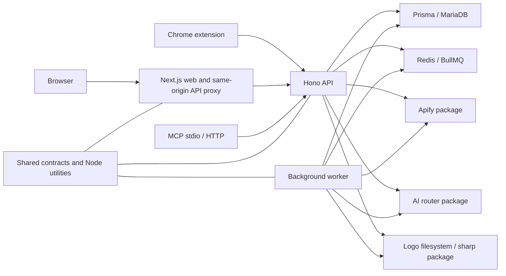

# ActorConsole architecture, shared utilities, readiness and SCA audit

Date: 2026-10-26 UTC. This is a scoped input to the parent audit, not a complete product security sign-off.

## Executive result and authorization

The untouched baseline passes the local source gates, applies all 73 migrations to a fresh disposable MariaDB database, passes the three explicitly enabled database integration tests, and starts all four server processes in local production mode. The production Docker image could not be built: Corepack's pnpm download failed inside the Docker build. Container runtime readiness therefore remains unverified.

There are **zero additional unique launch-blocking product findings from this scope**. AQ-01 is the same raw-path metric-cardinality issue already reported by the API/data owner and should be counted once in the consolidated launch-blocker total. Its blocking recommendation is supported by three anonymous requests through the actual app and uncapped storage in source. Other confirmed issues below are regression-gate holes, utility contract defects, a cache race, ineffective install-script policy, and manual-backup permissions. Dependency version exposure is confirmed; vulnerability exploitability has not been established for all advisory paths.

The initial delegation authorized scoped fixes. A later planning-only instruction superseded that authorization. All application and test-infrastructure edits stopped at that point. Four already edited files were preserved, without reset, branch creation or commit. Subsequent changes are these audit documents and scratch/evidence files only. No push, merge, deployment, production request, real payment, credential provisioning, CI/CD edit or security-setting change was performed. Local test fixture values are deliberately synthetic. Worker boot used an outbound network guard; provider work was not validated.

Top priorities for the parent:

1. Reconcile AQ-01 with the API/data report and fix route-label cardinality before launch.
2. Review the preserved test-runner diff: the baseline release gate omits 148 existing tests across three workspaces.
3. Make the database integration suite run in the intended gate; it is skipped by the checked-in CI configuration.
4. Triage the SMTP-reachable Nodemailer exposure and the other advisory paths with their owners.
5. Complete a verified production-image build and boot; the successful local Node boot does not substitute for this.

## Repository and baseline evidence

| Item | Verified result |
| --- | --- |
| Repository | `https://github.com/Coding-Frontend/actorconsole.git` |
| Task checkout | `/workspace/actorconsole` |
| Initial/local branch | `work`; no local `main` ref was present |
| Initial commit/base | `fc52f547286b14de2f483899b4aa5dcdfca8b5ea` |
| Subject | `Update dependencies with Zod 4, Vite 8 and Sentry 11 compatibility fixes (#37)` |
| Remote main verification | `git ls-remote origin refs/heads/main` returned the same full SHA |
| Initial worktree | Clean |
| Untouched scratch baseline | `/workspace/audit-baseline/actorconsole`, extracted with `git archive` |
| Source integrity | All 1,208 tracked files matched their Git blob hashes before and after gates/readiness |
| Tool versions | Node `v24.19.0`, pinned pnpm `9.15.0`, installed Vitest `2.1.9`; CI requests Node 22 |
| Domain | No product website domain assumed or contacted |

The scratch baseline has its own workspace dependency links, generated outputs and Prisma-generated files. Installed third-party dependency files were reused locally; this was not a fresh registry installation. Its tracked sources remained byte-for-byte identical to the base. The original task checkout and its four preserved edits were not switched or reset.

Instructions reviewed: `README.md`, `CONTRIBUTING.md`, `SECURITY.md`, `APIFY.md`, environment examples, `deployment.instructions.md`, `docs/RUNBOOK.md`, `docs/CREDENTIALS.md`, `docs/ACTOR_INTELLIGENCE.md`, `docs/AI-PROVIDERS.md`, `THIRD_PARTY_NOTICES.md`, manifests, test configs, Dockerfile and workflow definitions. No `AGENTS.md`, `CLAUDE.md`, local `.agents/skills`, dedicated known-issues document, progress document, architecture document or launch checklist was found. Template placeholders were resolved against actual files. The private historical audit referenced in `docs/CREDENTIALS.md` was not available.

## Gate results: baseline versus preserved WIP

Commands used pinned pnpm via `PATH=/tmp/actorconsole-pnpm-bin:$PATH COREPACK_HOME=/tmp/actorconsole-corepack`. Logs are under `/workspace/audit-artifacts/architecture-quality`.

| Check | Untouched base | Preserved WIP |
| --- | --- | --- |
| `pnpm typecheck` | PASS: 11 typecheck tasks plus 5 prerequisite builds, 16 total; 21.064 s | PASS: 16 total tasks; 21.322 s |
| `pnpm lint` | PASS: 11 workspace tasks; 13.849 s | PASS: 11 workspace tasks; 14.173 s |
| `pnpm run test --maxWorkers=2 --minWorkers=1` | PASS: 231 files passed, 1 skipped; **1,832 tests passed, 3 skipped**; 68.00 s | PASS: 231 files passed, 1 skipped; **1,835 tests passed, 3 skipped**; 66.28 s |
| `pnpm test:coverage` | PASS: existing seven workspaces, 1,684 passed / 3 skipped; excludes three suites, AQ-02 | PASS: all ten test-bearing workspaces, 1,835 passed / 3 skipped; same seven coverage thresholds |
| `pnpm test:scripts` | PASS: 6 tests | PASS: 12 tests, including 6 new runner tests |
| `pnpm build` | PASS: 10 tasks; 55.948 s | PASS: 10 tasks; 50.186 s |
| `python scripts/test-vps-release.py` and receiver `bash -n` | PASS: 5 archive-boundary tests and shell syntax | No further WIP run needed |
| Gitleaks 8.30.1, all available history | PASS: 15 commits, approximately 7.31 MB, no leaks found | Same history; this is not a scan of ignored private environment files |
| Fresh MariaDB migration deployment | PASS: 73 migrations, disposable database only | Not needed; schema unchanged |
| Explicit DB integration test | PASS: 1 file / 3 tests, none skipped | Not run separately |
| Local production process boot | PASS for API, web, MCP and worker, with outbound guard | Not used for baseline sign-off |
| Actual Docker image build | FAILED at Dockerfile:14, pnpm download; no image/runtime pass | Not attempted against WIP |

Baseline build used synthetic browser settings, `API_BASE_URL=http://127.0.0.1:9`, disabled optional telemetry/uploading, and no private environment files. It verifies compilation and static generation, not successful provider or live catalog access. The local Node version differs from CI's requested major.

Initial diagnostics before prerequisites were prepared failed: the environment's default pnpm 11 tried an automatic install into a read-only home path, and an initial direct test run reported 69 failed files because built workspace entries and Prisma generation were absent. Pinning the already requested pnpm and generating/building local artifacts resolved those environmental prerequisites. They are not reported as product defects.

An intentionally impossible 101% coverage threshold failed with the expected threshold errors under pnpm 9.15. The baseline coverage CLI does enforce its existing thresholds. Installed implementation evidence: `node_modules/vitest/dist/coverage.js:262`, which sets `process.exitCode = 1` for a missed threshold.

### Coverage scope, not whole-repository percentages

| Workspace | Instrumented source files | Baseline line coverage | WIP line coverage |
| --- | ---: | ---: | ---: |
| shared | 9 | 94.07% | 94.12% |
| ai | 1 | 88.19% | Same |
| apify | 1 | 83.33% | Same |
| db | 1 | 100% | Same |
| api | 20 | 90.38% | Same |
| worker | 2 | 98.59% | Same |
| web | 8 | 99.36% | Same |

These percentages intentionally cover selected files. They do not establish coverage of entire workspaces. For example, database coverage instruments `src/index.ts`, not every transaction helper, and worker coverage instruments leader election/retention, not its 2,490-line entry point.

## Architecture map

MCP's runtime package is intentionally API-based and independently bundled. The web boundary script prohibits direct DB/provider SDK imports. Shared has browser-safe subpath exports and a root barrel that also exports Node crypto, logging, monitoring and email utilities; future extractions should preserve the browser/server boundary rather than expand that root indiscriminately.

| Module | Source files / lines | Test files | Responsibility |
| --- | ---: | ---: | --- |
| apps/web | 524 / 69,402 | 114 | Marketing, dashboard, admin, proxy, middleware |
| apps/api | 93 / 25,183 | 64 | Authentication, authorization, billing, workspace and public catalog API |
| apps/worker | 13 / 4,849 | 10 | Schedulers, catalog/insight sync, publishing, email, retention |
| apps/mcp | 18 / 1,743 | 5 | Scoped workspace tool protocol |
| apps/chrome-extension | 13 / 4,027 | 5 | Explicit browser-to-workspace connection and resume flows |
| packages/shared | 46 / 4,166 | 19 | Contracts, plans, crypto, metrics, logging and email templates |
| packages/apify | 10 / 4,301 | 6 | Apify API/Console access and conversion |
| packages/db | 7 / 891 | 5 | Prisma and transaction/auth helpers; schema/migrations counted separately |
| packages/ai | 4 / 633 | 3 | Provider routing and prompts |
| packages/logo-catalog | 1 / 454 | 1 | Logo discovery, normalization and filesystem storage |
| packages/config | Presets outside `src` | 0 | Shared TypeScript/Tailwind configuration |

Counts exclude dependencies, outputs and tests from source-line totals. API and worker both depend on AI, Apify, DB, logo-catalog and shared. AI and Apify depend on DB and shared. DB depends on shared. Web depends on shared. This makes changes to shared contracts particularly sensitive to integration order.

## Findings register

Baseline line numbers below refer to `fc52f54` unless explicitly marked current WIP. CONFIRMED means a failing assertion, bounded local request/response, or reachable source path is provided. SUSPECTED means more evidence is required.

| ID | Finding | Severity | Status | Launch blocking | Owner / cross-reference |
| --- | --- | --- | --- | --- | --- |
| AQ-01 | Raw request paths create unbounded metric series | High | CONFIRMED; still present | Yes, already counted by API/data owner | API/data canonical issue; shared metrics storage seam |
| AQ-02 | Release test runner omits three workspace suites | Medium | CONFIRMED at base; preserved WIP mitigation | No separate product failure established | This test-infrastructure scope |
| AQ-03 | Metric serializer emits malformed/newline labels and incomplete/out-of-order buckets | Medium | CONFIRMED at base; preserved WIP mitigation | No | This standalone shared utility scope |
| AQ-04 | Database integration tests never enabled by checked-in CI env | Medium | CONFIRMED gate hole; tests pass when opted in locally | Verification gap | Test infrastructure; CI owner must coordinate any future CI edit |
| AQ-05 | Inherited object properties violate two shared lookup contracts | Low | CONFIRMED utility defect; external exploitability unproven | No; current callers constrain names/plans | Shared utility; API/worker entitlement seam |
| AQ-06 | Failed expired public-cache request deletes a fresh replacement | Medium | CONFIRMED; untouched | No; extra origin work, not data disclosure demonstrated | API/data owner; do not duplicate a fix here |
| AQ-07 | `allowBuilds` is not enforced by pinned pnpm 9.15 | Medium | CONFIRMED source and offline install fixture | No malicious package established | Dependency/toolchain owner |
| AQ-08 | Direct backup invocation can create readable plaintext archives | Medium | CONFIRMED under umask 022; receiver has mitigation | No; depends on operational access context | Operations/scripts owner |
| SCA-01 | 27 registry advisories match production dependency graph versions | High advisory maximum | Version exposure CONFIRMED; exploitability partly SUSPECTED | Owner triage required; no automatic 27-blocker count | SMTP, web/build, provider and DB/toolchain owners |

### AQ-01: metrics cardinality — shared evidence, count once

Reachable path: every request passes `apps/api/src/app.ts:77`; `app.ts:85` derives a label from the raw path, replacing only long alphanumeric segments. Unknown short paths stay distinct. `packages/shared/src/metrics.ts:6`, `:23` and `:35` retain new counters/histograms in process-local Maps without a size bound or expiry. There is no authentication requirement on this middleware or the 404 path.

Reproduction: `node /workspace/audit-artifacts/architecture-quality/app-cardinality.mjs`. It makes exactly three in-memory requests through the actual compiled Hono app, with DB/Redis configuration removed. `GET /audit-a`, `/audit-b`, `/audit-c` each returned 404 and JSON `{ "ok": false, "error": { "code": "not_found", "message": "No route for GET /audit-a" } }` (path substituted). The assertion expecting a shared bounded 404 label failed: **3 series versus 1**. No load test or external traffic was used.

Evidence: `app-cardinality.log`; source path is unchanged by preserved edits. Impact: callers can continuously add retained state using anonymous distinct paths, increasing process memory and scrape work. Finite label vocabularies should be introduced at the API instrumentation boundary; a shared storage ceiling/overflow policy requires agreement so useful metrics are not silently lost. The API/data owner already reported this as launch blocking. Reconcile that record with this evidence and retain a single issue.

### AQ-02: three test-bearing workspaces omitted from the release gate

Baseline `scripts/test-coverage.mjs:3` lists only seven packages; `.github/workflows/ci.yml` invokes `pnpm test:coverage`, not the complete root Vitest workspace. `vitest.workspace.ts` includes all ten test-bearing workspaces. Omitted: logo-catalog (13 tests), Chrome extension (27), MCP (108), **148 tests / 11 files** total. A failing test in any omitted suite cannot fail that baseline release test entry point.

The pre-planning diff adds those suites without introducing new numeric coverage requirements. `scripts/test-coverage.test.mjs:6` compares invoked workspaces with real manifests; `:23` protects the seven existing thresholds, and `:36` checks subprocess failure propagation. `node --test scripts/test-coverage.test.mjs` passed 6/6; `pnpm test:coverage` passed all ten workspaces. This is preserved uncommitted mitigation, not a change on main. Workflow files were not edited.

### AQ-03: metrics output contracts

At baseline, `packages/shared/src/metrics.ts:15` escapes quotes/backslashes but not linefeeds. Its bucket loop only creates buckets after a matching observation and its output loop uses insertion order. A high observation followed by a low one can put `+Inf` before finite buckets. The [Prometheus exposition specification](https://prometheus.io/docs/instrumenting/exposition_formats/) requires escaped label linefeeds and increasing histogram bucket order.

Regression command before the implementation edit: `pnpm --filter @actorconsole/shared test src/metrics.test.ts`. Log `actorconsole-metrics-red.log` records **3 failed / 2 passed**: a label split samples into extra lines; configured empty buckets were absent; order was `+Inf,10,0.1,2`. The preserved change escapes linefeeds, creates zero-count configured buckets and sorts output numerically. The same command passed **5/5**, shared typecheck and lint passed, and both workspace-wide gates above passed. Newline exploitability through current HTTP paths was not demonstrated; this is a serializer-contract finding, not a proven remote log-injection exploit.

### AQ-04: integration suite is opt-in but CI never opts in

`apps/api/test/intelligence.integration.test.ts:10` requires `ACTORCONSOLE_TEST_DATABASE_URL === DATABASE_URL` and a loopback schema named `actorconsole_intelligence_test` or `_preview`. `.github/workflows/ci.yml:56` sets neither the marker nor a matching schema name; it uses `actorconsole_test`. Consequently the suite remains skipped even though CI provisions MariaDB and applies migrations.

The untouched root baseline gate reports **3 skipped tests**. Explicit command (synthetic disposable target only): `DATABASE_URL=<loopback disposable URL> ACTORCONSOLE_TEST_DATABASE_URL=<same URL> pnpm --filter @actorconsole/api test test/intelligence.integration.test.ts`. Log `baseline-db-integration.log` records **3 passed, none skipped** against the 73 migrated tables/history. This validates the suite's present behavior; it does not repair the missing CI activation. Preserve its restrictive database guard.

### AQ-05: inherited names bypass “unknown” lookup behavior

`packages/shared/src/queue/retry-policies.ts:77` promises undefined for unregistered queue names but indexes a normal object. `retryPolicyFor("constructor")` returns `Object`, `"toString"` returns a function, and `"__proto__"` returns the prototype. `packages/shared/src/plans.ts:128` similarly calls `.has()` on an inherited property and throws for those strings, whereas ordinary unknown strings fall back to Free.

Command: `NODE_ENV=test node --import tsx --test /workspace/audit-artifacts/architecture-quality/shared-contracts.test.mjs`. The two corresponding assertions failed. Evidence: `shared-contracts.log`. Reachable consumers are API `src/lib/queue.ts:113`, API `src/lib/plan-access.ts:149`, and worker `src/index.ts:912`; current queue unions and stored plan enums constrain normal production inputs. No bypass or remotely reachable arbitrary plan input was established. Future fix: own-property checks with the existing unknown-value semantics; no entitlement-policy change.

### AQ-06: stale cache failure evicts the replacement

`apps/api/src/lib/public-cache.ts:11` unconditionally deletes the key when an old load rejects. Sequence: start A; expire its TTL; cache successful B under the same key; reject A; read again. A's catch removes B. Callers include cached public builder and research queries, so failures/timeouts can cause redundant origin work.

The third assertion in `shared-contracts.test.mjs` uses two clock values and deferred promises, without network or real delay. Expected two loader calls; observed **3**, and the assertion failed. Same source at baseline and WIP. This is an API-owned seam: recommend deleting only when the stored promise is still the failing promise. Do not edit it independently in another chat.

### AQ-07: installer trust policy uses unsupported configuration

`package.json` pins pnpm 9.15.0 and Dockerfile:14 installs that version, while `pnpm-workspace.yaml:8` uses `allowBuilds`. Installed pinned implementation `/tmp/actorconsole-corepack/v1/pnpm/9.15.0/dist/pnpm.cjs:20187` reads `manifest.pnpm.onlyBuiltDependencies`/`neverBuiltDependencies`; its policy at `:134815` returns no restriction when neither is configured. The pinned implementation contains no `allowBuilds` handler.

An offline disposable fixture used `allowBuilds: { local-allowed: true }` plus a local file dependency named `local-disallowed`, whose postinstall only writes a marker. `pnpm install --offline --store-dir <fixture/store>` completed, downloaded **0** packages, and executed the unlisted dependency's postinstall. `install-policy.log` and `install-policy-fixture/postinstall-marker.txt` retain evidence. No real dependency was added, upgraded or executed for this reproduction. This falsifies the apparent allowlist, not a claim that an existing package is malicious.

### AQ-08: manual backups depend on caller umask

`scripts/backup-db.sh:2` does not set a restrictive umask. `:9` creates the backup directory; output redirection later creates the SQL gzip archive under the inherited umask. The runbook's direct invocation at `docs/RUNBOOK.md:21` does not set one either. `.deploy/actorconsole-deploy:3` sets `umask 077`, mitigating its deployment-triggered invocation.

A real backup of the disposable database followed by restore to a separate disposable schema succeeded. A marker row and all **73** migration records were restored. With explicit `umask 022`, archive permissions were **0644**, directory **0755**, and encryption was off unless explicitly configured. `backup-restore-result.json` records those values; `python .../backup-permissions-check.py` intentionally fails expecting 0600. This is not evidence of public HTTP exposure. Restrictive ownership/permissions and optional encryption configuration need an explicit operational contract; the script should not rely solely on the receiver's umask.

## Supply-chain inventory and reachability

`pnpm audit --prod --json` returned **27 advisories: 10 high, 15 moderate, 2 low, 0 critical**, over 1,076 dependency entries. This is package metadata, not 27 demonstrated application exploits. Full advisory IDs, titles, ranges and paths are preserved in `dependency-advisories-summary.json`; no dependency manifest or lockfile was changed.

| Resolved affected package | Advisories | Actual installed evidence | Production reachability assessment |
| --- | --- | --- | --- |
| nodemailer 7.0.7 | 5 high, 12 moderate, 1 low | `node_modules/nodemailer/package.json:3`; `lib/addressparser/index.js:88` recurses | **SMTP runtime reachable**: API `src/lib/email.ts:117`, worker `src/index.ts:196` call `sendMail`. Which advisory-specific options/inputs are attacker-controlled requires SMTP-owner review. Raw/jsonTransport/OAuth-specific findings are not all proved reachable by those calls. |
| postcss 8.4.31 under Next 15.5.28 | 2 high, 2 moderate | `node_modules/next/package.json:88`, nested `next/node_modules/postcss/package.json` | **Build processing reachable**; no user-supplied CSS processing in a production request was identified. Root PostCSS 8.5.31 does not replace this nested copy. |
| deepmerge-ts 7.1.5 | 1 high | `node_modules/@prisma/config/package.json:16` | Prisma configuration/migration tooling, present in retained backend dependencies. No unauthenticated runtime merge of attacker-controlled recursive objects established. |
| @grpc/grpc-js 1.9.16 under Firestore | 1 high, 1 low | `node_modules/@firebase/firestore/package.json:142` and its nested package | Installed exposure confirmed. Web uses Firebase app/auth/analytics; no Firestore/gRPC server or affected mTLS server path found. Root gRPC 1.14.6 does not remove the nested copy. |
| basic-ftp 5.3.1 | 1 high | `node_modules/get-uri/package.json`, installed basic-ftp manifest | Apify client's proxy/PAC stack can load it. Direct app FTP listing or attacker-selected PAC/FTP path not established. |
| postcss-selector-parser 6.1.5 | 1 moderate | Installed manifest, Tailwind/postcss-nested chain | CSS build path; arbitrary request-time selector processing not established. |

Examples of upstream metadata preserved for owner triage: Nodemailer [recursive parser DoS](https://github.com/advisories/GHSA-rcmh-qjqh-p98v), [raw message bypass](https://github.com/advisories/GHSA-p6gq-j5cr-w38f), [OAuth TLS validation](https://github.com/advisories/GHSA-r7g4-qg5f-qqm2); nested PostCSS [source map file disclosure](https://github.com/advisories/GHSA-6g55-p6wh-862q). Exploit tests against external providers were not performed.

Selected `pnpm -r outdated ... --format json` result: Nodemailer 7.0.7 → latest 10.2.1; Next 15.5.28 → 16.4.3; Firebase 12.19.0 → 13.1.0; Prisma client 6.19.3 → 7.10.1. These are registry observations, **not blanket upgrade recommendations**; major compatibility and contract tests are required. Exact versions/ranges and dependent workspace names are in `actorconsole-outdated.json`.

### Installed packages, scripts, licenses and lockfile

Read-only installed inventory found **1,247 unique package/version pairs**, including development and platform packages, versus **1,421 lockfile package records**. All 1,421 lock records have resolution integrity values. This verifies presence of integrity data, not a fresh independent verification of every installed file against registry tarballs.

Ten package/version pairs declare install lifecycle scripts: `@firebase/util@1.15.3`, `@google/genai@2.31.0`, `@prisma/client@6.19.3`, `@prisma/engines@6.19.3`, `esbuild@0.28.2`, `esbuild@0.21.5`, `msgpackr-extract@3.0.4`, `prisma@6.19.3`, `protobufjs@7.6.6`, `unrs-resolver@1.12.2`. Declarations and exact script strings are in `actorconsole-installed-inventory.json`; the Google preinstall is declared as a no-op. Declaration does not by itself imply maliciousness.

License declarations: 907 MIT, 218 Apache-2.0, 57 ISC, 24 BSD-3-Clause, 15 BSD-2-Clause, plus smaller groups. Distribution review should explicitly account for the LGPL libvips binaries (`@img/sharp-libvips-*`), MPL-2.0 packages (axe-core/lightningcss), and `sentry@0.45.0` declaring FSL-1.1-Apache-2.0. See `actorconsole-special-licenses.json`. No legal-compliance conclusion is made from package metadata alone. Existing third-party notices cover fonts and product icons; check notices in the eventual distribution artifact as well, particularly emitted font files.

Version duplication is mostly transitive rather than mismatched direct declarations: installed Vitest uses Vite 5.4.21 while web's plugin/build uses the newer nested Vite; Sentry Node 10.x and Next SDK 11.x coexist; PostCSS and gRPC have multiple installed versions. Root declarations differ only in exact versus caret ioredis specs, with resolved 5.11.1. Consolidation should be justified by compatibility evidence, not by version count alone.

### Container observations and unresolved image test

Dockerfile:11 uses mutable `node:22-alpine`; no base digest is pinned. Backend runtime stages copy the complete installed dependency tree and workspace packages, including development/tooling content; web uses standalone output and `USER node`, while API/worker/MCP stages do not set `USER`. These are source-confirmed hardening/size considerations, not demonstrated application exploits. Preserve the migration/seed tool requirements if runtime pruning is proposed.

`.dockerignore` excludes all environment variants, private tool caches and archives. This boundary was inspected, but an image-layer inventory could not be produced. The actual command was `docker build --target api --label actorconsole.audit=architecture-quality --label org.opencontainers.image.revision=<base> -t actorconsole-audit-api:fc52f54 .` in the untouched scratch baseline. Docker's default buildx config initially targeted a read-only home directory; a scratch `DOCKER_CONFIG` resolved that client-local prerequisite. The real build then failed at Dockerfile:14: Corepack could not fetch `https://registry.npmjs.org/pnpm/-/pnpm-9.15.0.tgz`. The log does not expose a more precise underlying network cause. TLS/integrity verification was not disabled. No application image was produced or run. Worker/MCP/web image builds were not redundantly attempted because they share that failing base stage.

## Readiness and operational claims

### Disposable data and production-mode processes

MariaDB 10.11 and Redis 7 Alpine were started with task-specific names, synthetic fixture values, loopback bindings, and no production volumes. MariaDB used tmpfs for `/var/lib/mysql`. The test target was `actorconsole_intelligence_test`, restoration target `actorconsole_restore_test`, host ports 43306 and 46379. Source migration count and database completed migration count both equal 73. Initial users and Actors were zero after the integration suite cleaned up. No provider credentials or live accounts were inserted.

`production-boot.py` launched compiled untouched-baseline API, web standalone server, MCP HTTP server and worker with `NODE_ENV=production`. `deny-external-network.mjs` rejects every non-loopback Socket connection before connect. The worker reached `Worker listening`; its automatic catalog attempt was blocked by that guard. This verifies process initialization, schema connectivity and scheduler registration, not live catalog/provider completion.

| Local probe | Result |
| --- | --- |
| API `:44000/health/ready` | 200; DB and Redis checks ok |
| MCP `:44100/health` | 200 |
| Web `:48080/api/health` | 200 |
| Web `/` | 200 |
| Web `/admin` anonymously | 307 to local `/login?callbackUrl=%2Fadmin` |
| API `/account/me` anonymously | 401 |
| API `/admin` anonymously | 401 |
| API unknown route | 404, structured error |

Raw status, headers and bounded body excerpts are in `production-boot.json`. API responses included HSTS, nosniff and SAMEORIGIN; web responses included DENY and nosniff. These samples do not replace the security owners' full header/CSRF/role matrix. All four local Node processes were terminated after checks.

The backup and restore scripts ran unchanged, using disposable container client adapters because host `mysql`/`mysqldump` executables were absent. The restored marker and 73 migration rows were verified. No encrypted-backup or offsite S3/GPG test was run; no remote storage call was made.

### Concrete schedules found in source and Redis

These are BullMQ schedules, not HTTP cron URLs. Redis registration was inspected after guarded worker boot.

| Job | UTC schedule / behavior | Source |
| --- | --- | --- |
| Daily Actor snapshots | 02:00 daily | worker `index.ts:2076` |
| Full Store search | 01:00 daily, plus startup catch-up when incomplete | `:2087`, `:2107` |
| Store details | minute 15 every hour | `:2092` |
| Website classification | 03:30 daily | `:2097` |
| Website logo enrichment | 04:00 daily | `:2102` |
| Due publishing schedules | immediate tick, then 30–35 seconds with leader lock | `:2017`, `:2170` |
| Usage-cost sync | immediate, then every 6 hours with lock | `:2370` onward |
| Snapshot retention / due-user purge / grant expiry | immediate, then every 24 hours with lock | `:2388` onward |

Snapshot retention defaults to 90 days and validates its environment setting. Whether all product-specific records meet published retention promises is a domain/privacy-owner review; this scope does not infer completeness from the existing ActorSnapshot cleanup test.

### Verified sound within the stated limits

- Pinned pnpm coverage thresholds fail when deliberately made impossible; existing tests do not silently ignore the coverage flags.
- Source typecheck/lint/test/build gates pass on an independently verified untouched archive.
- All checked-in migrations apply to empty MariaDB 10.11; the opt-in DB suite passes when actually enabled.
- Production-mode local readiness reaches both DB and Redis; anonymous protected probes deny access.
- Existing archive verifier tests reject private environment files, traversal, symlinks, modified hashes and wrong revisions. This is an existing gate, not a new finding.
- All available Git history passed checksum-verified Gitleaks 8.30.1 with full redaction. Historical revocation is a separate claim.
- Backup/restore functionality preserved a fixture and migration history across separate disposable schemas.
- Public catalog cache and web pending-read maps have explicit entry caps; the general fallback cache and metrics maps do not have equivalent caps. No blanket “all caches leak” finding is made.

### Not verified / pending owner or user verification

- Production container build/boot and final image layer/SBOM/notice inventory: blocked by the package-download failure above; no pass claimed.
- Full browser golden paths, authenticated admin roles, purchase/refund/email/provider outcomes: outside this scope's local anonymous readiness checks and intentionally left for the respective owners. No production payment or provider call was attempted.
- Policy publication, operational inbox delivery and OAuth project setup: depend on installation configuration and human checks; not established by code or an empty DB boot.
- Historical credential revocation cited by `docs/CREDENTIALS.md` under “Before publication”: known issue, **not new**; cannot verify issuer-side revocation locally. The private audit and old remote were not examined.
- Real uptime probes, log rotation/retention, offsite backup encryption and restore access, monitoring ownership and incident contact roster: not established by `docs/RUNBOOK.md`; verify installation evidence. Optional Sentry/OTEL config being present is not delivery verification.
- No repository launch checklist was available; no fabricated done/not-done checklist is substituted.

No residual risk was accepted on the user's behalf. Deferred work and untested paths remain open.

## Duplication, dead-code candidates and performance backlog

These are recommendations for coordination, not extra security findings or edits. Static import scans and repeated source blocks were manually checked; framework/build entry points were excluded from dead-code claims.

| Priority | Evidence / opportunity | Suggested owner and first verification |
| --- | --- | --- |
| P1 | AQ-01 unbounded metrics; API source label + shared storage | API/data owner canonical; bounded three-path regression first |
| P1 | AQ-02/AQ-04 missing suite execution | Test infrastructure; preserve numeric policy and DB guard |
| P1 | SMTP-reachable SCA paths; ineffective installer allowlist | Dependency + email owners; compatibility and offline lifecycle fixture |
| P2 | AQ-06 cache replacement race | API/data; deferred-promise identity regression |
| P2 | Large public builder queries materialize snapshots/aggregates before JS sorting/pagination: API `builders.ts:817`, `:839`, `:1220` | API/catalog; inspect representative scratch query plans, then functional result equivalence; **scaling bottleneck suspected**, no load test performed |
| P2 | UI actor-detail first-load JS about 401 kB; all-workspaces 271 kB; shared 103 kB, from baseline Next build | UI owner; bundle inspection before code splitting; no measured user-latency claim |
| P2 | Web/API duplicate `buildDailyPortfolioTrends`: API `builders.ts:1035`, web `:301`; copied publication/picture logic | Catalog + web owners; shared pure contract tests and owner-coordinated extraction |
| P2 | RSS implementation duplicated in API `changelog-feed.ts:10` and web `:3`; research filters duplicated API `actor-research.ts:37` / web `:39` | Content/research owners; extract browser-safe pure helpers only after behavior parity tests |
| P2 | API `cache.ts:35` fallback Map evicts expired entries only on reread; no global bound/sweep | API infrastructure owner; **retention/scaling concern suspected**, trace externally variable keys before severity assignment |
| P3 | HTML entity helpers repeated in shared email base/OTP/newsletter/ticket-reply and API email | Shared/email owners; preserve distinct text/attribute/URL trust contexts; no XSS conclusion from duplication |
| P3 | API `test/helpers.ts` exported helpers have no imports; fixture `hono-app.ts` mostly unused apart from session token | Test infrastructure; verify all test/script imports before removal, then converge on one production-error-handler fixture |

Largest modules: API admin routes 3,118 lines; web usage-cost analytics 2,736; worker entry 2,490; Apify client 2,328; API actors 2,098; extension sidepanel 1,886; web financial analytics 1,787; API account routes 1,714. Size is a maintenance signal, not a defect by itself. Domain refactors belong to their owners and should preserve policy/transaction boundaries.

**Dead-code candidates, not deleted:** web `hooks/use-scroll-progress.ts`, `components/charts/mini-trend-chart.tsx`, `components/dashboard/account-usage-analytics.tsx`, `usage-cost-chart.tsx`, `components/marketing/parallax-horizontal.tsx`, old marketing `actor-mark.tsx` re-export, and UI `animated-counter`, `animated-section`, `confetti`, `fade-in`. Static repository searches found no production imports. Web `lib/public-actor-content.ts` is used only by its tests; API has the active parser. Web `builders.ts` exports `newlyPublishedWhere`, `effectiveActorPicture` and `buildDailyPortfolioTrends` referenced only by web tests, while API owns active implementations. **Do not delete `pricingEntries`**: the research view consumes it. Do not misclassify extension build entry points, Next middleware, Sentry privacy helpers, or the explicit worker maintenance script as dead.

## Ownership requiring assignment

No `CODEOWNERS` file exists, and this chat cannot see all other chats' live assignments. The following are therefore **ownership gaps to confirm**, not declarations that nobody works on them:

- Test runner, shared test fixtures, selected coverage policy, DB-test activation: this audit scope / integration owner.
- `packages/config`, compiler/build compatibility, `scripts/fix-esm-imports.mjs`: explicit toolchain owner needed.
- Shared metrics/logging/tracing lifecycle and memory budgets: shared infrastructure owner, coordinated with API instrumentation.
- Shared HTML/email primitives: shared utility owner plus email/security review.
- `packages/logo-catalog`, browser extension, MCP published-package contract: confirm named owners; their omission from the baseline gate must not make them effectively unowned.
- Dependency advisory triage, license/notice distribution, installer script policy: dependency/release owner.
- Backup/restore permissions, cron visibility, monitoring delivery and incident roster: operations owner.

## Exact preserved files, evidence and handoff

Pre-planning source/test changes, all uncommitted:

| File | Preserved change |
| --- | --- |
| `packages/shared/src/metrics.ts` | 12 added / 7 removed lines; serializer/bucket fixes |
| `packages/shared/src/metrics.test.ts` | 33 added lines; three regressions |
| `scripts/test-coverage.mjs` | 26 added / 8 removed lines; three suites and testable runner |
| `scripts/test-coverage.test.mjs` | New, 54 lines; six runner regressions |

New deliverables: this report and `docs/plans/architecture-readiness-remediation.md`. No other tracked application file changed. Source/content verification and final diff inspection are part of the handoff; the preserved patch is `pre-planning-edits.patch` in the artifact directory. Applying or integrating it is a later decision under the planning-only instruction.

Evidence root: `/workspace/audit-artifacts/architecture-quality/`. It contains baseline/WIP gate logs, source-hash verification, SCA metadata, exact bounded fixtures and their failing assertions, production-boot results, migration/backup/restore evidence and the failed Docker build log. Scratch baseline: `/workspace/audit-baseline/actorconsole`. No branch/commit was made. Local Node processes were stopped; disposable Docker services are cleaned up at final handoff, and their logs/results remain in the evidence directory.

Remaining blocker record: action **build and boot actual production images**, target **untouched baseline Dockerfile base/API stage and dependent targets**, outcome **build failed, not denied or uncertain**, reason **Corepack registry download failed**. Empty DB migration, DB integration, guarded Node production boot and backup restore completed independently. No automatic approval rejection occurred, and no denied access was routed around.
